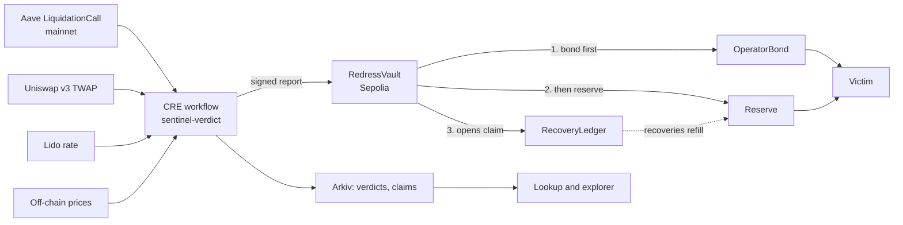

# Redress

> When an oracle gets it wrong, make people whole in blocks, not weeks.

On 10 March 2026 a misconfigured oracle undervalued wstETH on Aave, and healthy positions were liquidated. Repairing that took a DAO vote and weeks of manual work.

Redress is an automatic, evidence-based restitution layer. It re-checks each liquidation against prices the broken oracle could not touch, decides whether the position was really unhealthy, and pays the amount it can prove, from the oracle operator's bond first. It then opens a public claim against whoever benefited.

**This is a hackathon demo on testnets.** It replays real mainnet history, but every payout is a test token on Sepolia. It is economic restitution, not a reversal, and it handles no real funds.

## Results

Replaying the incident from real chain data:

| Measure | Result |
|---|---|
| Liquidation events | 47, covering 34 positions and 33 addresses |
| Verdicts | 46 `WRONGFUL`, 1 `AMBIGUOUS`. 33 of 34 positions wrongful on every event |
| Paid on Sepolia | 473.2955 test WETH to 33 addresses, equal to the offline replay to the wei |
| Paid from the bond, then the reserve | 100.0000 and 373.2955 |
| Against the DAO's 512.19 ETH | Floor paid −7.594%. Midpoint, for comparison only, −2.541% |
| False positives | 0 on 215 calm and 60 market-crash liquidations |

The PRD's target of 34 of 34 positions and ±2% of the DAO figure is **not met**. Redress pays only what it can prove, so the floor sits below the DAO's figure. Nothing was tuned to close the gap.

## How it works



1. A log trigger fires on an Aave `LiquidationCall`.
2. The workflow rebuilds the position at the block before, and forms an independent price band from the Lido rate, the Uniswap v3 TWAP and off-chain prices.
3. A pure verdict function asks whether the position was healthy across the whole band.
4. The workflow writes a report. The vault re-derives the amount and reverts if it differs by one wei.
5. The vault pays the provable floor, from the adapter's bond first and then the reserve.
6. A claim opens against the liquidator and the block builder.

Verdict logic is one pure function in TypeScript and Solidity, checked against shared vectors. See [`docs/VERDICT_SPEC.md`](docs/VERDICT_SPEC.md).

## Sponsor sections

### Uniswap

**U1: Uniswap v3 TWAP in every verdict.** The mainnet wstETH/WETH pool's 30-minute TWAP is source S2 for all 47 incident events.

| What | Where |
|---|---|
| `observe` read at the event block | [`cre/sentinel-verdict/handler.ts:298`](cre/sentinel-verdict/handler.ts#L298) |
| Tick cumulatives to mean tick | [`cre/sentinel-verdict/position.ts:44`](cre/sentinel-verdict/position.ts#L44) |
| Tick to price | [`cre/sentinel-verdict/position.ts:38`](cre/sentinel-verdict/position.ts#L38) |

**U3: `BandOracleHook`, a Uniswap v4 hook.** It gives a v4 pool a TWAP plus the lowest and highest ticks over a window, with no external oracle.

**The hook was not used in the incident replay.** The incident was on mainnet with a v3 pool. The Sepolia v4 pool is synthetic: we chose its price and made its swaps. It shows the mechanism and is not market evidence, and a test keeps it out of `replay.json`. Design and limits: [`docs/HOOK_DESIGN.md`](docs/HOOK_DESIGN.md).

| What | Where |
|---|---|
| Permission flags | [`contracts/src/hooks/BandOracleHook.sol:58`](contracts/src/hooks/BandOracleHook.sol#L58) |
| `getBand(key, window)` | [`contracts/src/hooks/BandOracleHook.sol:68`](contracts/src/hooks/BandOracleHook.sol#L68) |
| Pre-swap recording | [`contracts/src/hooks/BandOracleHook.sol:124`](contracts/src/hooks/BandOracleHook.sol#L124) |
| One observation per block | [`contracts/src/hooks/BandOracleHook.sol:133`](contracts/src/hooks/BandOracleHook.sol#L133) |
| Large-swap manipulation test | [`contracts/test/unit/BandOracleHook.t.sol:172`](contracts/test/unit/BandOracleHook.t.sol#L172) |
| Same-block sandwich test | [`contracts/test/unit/BandOracleHook.t.sol:82`](contracts/test/unit/BandOracleHook.t.sol#L82) |
| Address mining and pool setup | [`contracts/script/DeployHook.s.sol`](contracts/script/DeployHook.s.sol) |
| `v4Hook` source and its guards | [`cre/sentinel-verdict/v4hook.ts:34`](cre/sentinel-verdict/v4hook.ts#L34) |
| Hook read in the workflow | [`cre/sentinel-verdict/handler.ts:221`](cre/sentinel-verdict/handler.ts#L221) |

Deployed and verified: [`0xc555e1ca0a109a1f02d238455ff4feda7ba5d080`](https://sepolia.etherscan.io/address/0xc555e1ca0a109a1f02d238455ff4feda7ba5d080#code). Run the demo with `bun replay/demo-v4hook.ts`. Developer feedback: [`FEEDBACK.md`](FEEDBACK.md).

### Chainlink CRE

The whole pipeline is one CRE workflow, `sentinel-verdict`. It reads two chains (mainnet history and Sepolia), calls an external HTTP source, and writes a report with `--broadcast`.

| What | Where |
|---|---|
| Log trigger | [`cre/sentinel-verdict/main.ts:11`](cre/sentinel-verdict/main.ts#L11) |
| Handler | [`cre/sentinel-verdict/handler.ts:233`](cre/sentinel-verdict/handler.ts#L233) |
| HTTP source with median consensus | [`cre/sentinel-verdict/handler.ts:173`](cre/sentinel-verdict/handler.ts#L173) |
| Chainlink stETH/ETH feed read, kept as evidence | [`cre/sentinel-verdict/handler.ts:297`](cre/sentinel-verdict/handler.ts#L297) |
| Report encoding | [`cre/sentinel-verdict/report.ts`](cre/sentinel-verdict/report.ts) |
| Report receiver | [`contracts/src/RedressVault.sol:188`](contracts/src/RedressVault.sol#L188) |
| Targets | [`cre/project.yaml`](cre/project.yaml) |

Simulation transcript with `--broadcast`: [`docs/transcripts/sepolia.txt`](docs/transcripts/sepolia.txt). First vault transaction: [`0xc7ca7d754a…`](https://sepolia.etherscan.io/tx/0xc7ca7d754a1d35fe5648996103cf1b2fd2db0b4d35b3424e38a31309b724fdb0). All 47 are in [`replay/out/mirror-sepolia.json`](replay/out/mirror-sepolia.json).

**What breaks without CRE:** there would be no multi-source verdict with consensus and no authorised on-chain report, so the vault would have to trust one operator's server. In this demo CRE ran as a local simulation, so consensus across nodes was not exercised.

### Arkiv

Arkiv is the queryable index of verdicts, claims and recoveries. The lookup and the explorer read from it, and fall back to `replay.json` if it does not answer. Each response says which one served. The chain stays the source of truth.

- **Writer wallet:** `0xD19D988fAe15c6AF0CB18FD5D79bffa41F8c2683`
- **Published:** 128 entities in 13 batch transactions on Rabdi, listed in [`replay/out/arkiv.json`](replay/out/arkiv.json).
- **Client:** [`backend/arkiv.ts:75`](backend/arkiv.ts#L75), [`backend/arkiv.ts:96`](backend/arkiv.ts#L96)
- **Run a query:** see [`arkiv/schema.md`](arkiv/schema.md).
- **Sponsor files:** [`schema`](arkiv/schema.md), [`friction`](arkiv/friction.md), [`reach`](arkiv/reach.md), [`why-arkiv`](arkiv/why-arkiv.md), [`how-you-use-arkiv`](arkiv/how-you-use-arkiv.md), [`swarm`](arkiv/swarm.md).

Swarm is not built: it needs a postage batch and a Bee endpoint.

## Accountability

| What | Where |
|---|---|
| Waterfall: bond, then reserve, then claim | [`contracts/src/RedressVault.sol:248`](contracts/src/RedressVault.sol#L248) |
| Bond draw | [`contracts/src/OperatorBond.sol:128`](contracts/src/OperatorBond.sol#L128) |
| Withdrawal delay and window | [`contracts/src/OperatorBond.sol:114`](contracts/src/OperatorBond.sol#L114) |
| Claim opened by each payout | [`contracts/src/RecoveryLedger.sol:62`](contracts/src/RecoveryLedger.sol#L62) |
| Recovery re-credits the reserve | [`contracts/src/RecoveryLedger.sol:74`](contracts/src/RecoveryLedger.sol#L74) |
| Tests and invariants | [`contracts/test/unit/Accountability.t.sol`](contracts/test/unit/Accountability.t.sol), [`contracts/test/invariant/Accountability.invariant.t.sol`](contracts/test/invariant/Accountability.invariant.t.sol) |

The bond belongs to a demo operator. No real entity is named or accused.

## Sepolia deployment

| Contract | Address |
|---|---|
| `RedressVault` | [`0xaccfe6e8939d3143f7f70a550ebf29dcfc197609`](https://sepolia.etherscan.io/address/0xaccfe6e8939d3143f7f70a550ebf29dcfc197609#code) |
| `OperatorBond` | [`0x934d3fae4d7393ef34a35246b28aab0b05cddea4`](https://sepolia.etherscan.io/address/0x934d3fae4d7393ef34a35246b28aab0b05cddea4#code) |
| `RecoveryLedger` | [`0x82339ee18be49be221bac62c4fb30e2f1d7a055d`](https://sepolia.etherscan.io/address/0x82339ee18be49be221bac62c4fb30e2f1d7a055d#code) |
| `MockWETH` | [`0xa193cae8762aeedcbf4d73c96369b54e5100fba4`](https://sepolia.etherscan.io/address/0xa193cae8762aeedcbf4d73c96369b54e5100fba4#code) |
| `BandOracleHook` | [`0xc555e1ca0a109a1f02d238455ff4feda7ba5d080`](https://sepolia.etherscan.io/address/0xc555e1ca0a109a1f02d238455ff4feda7ba5d080#code) |

## Trust assumptions

- **Anyone can forge a report against this vault.** Simulated runs use `MockKeystoneForwarder`, which checks no signatures and supplies no workflow identity. A fork test proves it delivers forged reports, and an `eth_call` shows the same on Sepolia. This is why it holds test tokens only. Production needs the signature-checking forwarder and a deployed workflow.
- **The vault checks arithmetic, not facts.** It cannot see mainnet, so it trusts the report for the position, band, verdict, adapter, liquidator and builder. In production that trust rests on CRE consensus.
- **A registrar names bond operators.** It decides who may bond against an adapter, and it has no other power.
- **Claims are records, not enforcement.** Nothing can force a liquidator or builder to pay.

## Limitations

- **Log replay, not re-execution.** The workflow reads historical state, and the original liquidations are not run again.
- **Local CRE simulation.** One node, so DON consensus was not exercised.
- **Off-chain prices are a committed snapshot** served locally. DefiLlama is the only working off-chain series, and its provenance is unconfirmed. CoinGecko's wstETH history is wrong and is rejected on every incident event.
- **One manipulated source can block a payout.** Negative control 5 fails: see [`docs/SECURITY.md`](docs/SECURITY.md).
- **wstETH with WETH debt only.** Multi-asset positions are approximated, and the source set is specific to wstETH.
- **Self-reviewed.** [`docs/SECURITY.md`](docs/SECURITY.md) lists every finding. No external auditor has read this code.

## Negative controls

Run with `bun replay/controls.ts`. Results are in [`replay/out/controls.json`](replay/out/controls.json).

| Control | Result | Pass |
|---|---|---|
| Calm-day control | 215 events: 207 VALID, 8 INCONCLUSIVE. False positives: 0 | Yes |
| Volatility control (2024-08-05) | 60 events: 47 VALID, 13 INCONCLUSIVE. False positives: 0 | Yes |
| Over-pricing glitch | OVERPRICED, redress 0 wei | Yes |
| Source outage | INCONCLUSIVE, redress 0 wei, with one source left | Yes |
| Single-source manipulation (one source +5%) | Before WRONGFUL, 230533099950029831035 wei. After INCONCLUSIVE, 0 wei | **No** |
| Boundary position | 1 real incident event(s) AMBIGUOUS. Paid 1201768889703676 wei against a midpoint loss of 3878400737512551 wei | Yes |
| Reserve exhaustion | 1000 ETH reserve, budget 200 ETH: spent 199 ETH, 9 queued. Also enforced on-chain by a Forge test | Yes |

## Verified incident data

Read from chain by `replay/verify-onchain.mjs`. Full output: [`replay/data/verification-report.txt`](replay/data/verification-report.txt). Per-liquidation data: [`replay/data/incident-2026-03-10.json`](replay/data/incident-2026-03-10.json).

| Fact | On-chain value |
|---|---|
| Execution tx | block 24626860, 2026-03-10 11:46:11 UTC (fork block 24626859) |
| Core pool / oracle | `0x87870Bca3F3fD6335C3F4ce8392D69350B4fA4E2` / `0x54586bE62E3c3580375aE3723C145253060Ca0C2` |
| Prime pool / oracle | `0x4e033931ad43597d96D6bcc25c280717730B58B1` / `0xE3C061981870C0C7b1f3C4F4bB36B95f1F260BE6` (market id "Aave V3 Lido Ethereum") |
| Borrow cap cut | block 24627510 |
| CAPO realignment | block 24628089 |
| E-Mode bonus | 1% in both markets |
| E-Mode liquidation threshold | Core 95.0%, Prime 96.5% |
| Deepest Uniswap v3 pool | `0x109830a1AAaD605BbF02a9dFA7B0B92EC2FB7dAa` (0.01% fee) |

### Checked against official docs

| Item | Result | Source |
|---|---|---|
| CRE forwarder, Sepolia | Simulation `0x15fC6ae953E024d975e77382eEeC56A9101f9F88`, production `0xF8344CFd5c43616a4366C34E3EEE75af79a74482`. The vault must switch forwarder between the two | [Forwarder directory](https://docs.chain.link/cre/guides/workflow/using-evm-client/forwarder-directory-ts) |
| CRE quotas | 15 HTTP calls, 15 EVM reads, 50 KB report, 100-block log queries, per execution. Higher than the PRD figures, so the PRD budget still fits. Confirmed on the live page on 2026-11-07 | [Service quotas](https://docs.chain.link/cre/service-quotas) |
| Uniswap Sepolia | Addresses and activity are in [`docs/HOOK_DESIGN.md`](docs/HOOK_DESIGN.md) | [v4 deployments](https://developers.uniswap.org/docs/protocols/v4/deployments) |
| Arkiv testnet | Rabdi, chain ID 7794095, read from the chain config in `@arkiv-network/sdk` 1.0.1 and confirmed against the live RPC | SDK source |

### Off-chain price sources (S3)

`replay/data/offchain-prices.json` holds two series fetched by `replay/fetch-offchain.ts`, stored as fetched with URLs, fetch date and timestamps. Nothing was removed by hand: the engine's outlier rejection decides what enters the band.

| Series | Result | Overlap with S1 and S2 |
|---|---|---|
| [DefiLlama](https://coins.llama.fi) `batchHistorical`, wstETH USD / WETH USD | Used. Median 18.5 bps from the Lido rate | **Provenance unconfirmed.** A [2022 article](https://www.chaincatcher.com/en/article/2079733) says DefiLlama starts from CoinGecko and falls back to DEX markets including Uniswap, so a Uniswap input cannot be ruled out. Measured: 13 bps median from S2, and its deviation from Lido has a 0.12 correlation with S2's, so it is not a copy of that pool. It is also 14.5 bps from the Lido rate on a wstETH/stETH basis, so it is not the Lido rate either |
| [CoinGecko](https://api.coingecko.com) `market_chart/range`, wstETH in ETH | **Rejected on every incident event.** Median 1,394 bps from the Lido rate. The stored series reads 1.02 to 1.08 ETH against a true ~1.23, in February as well as March, while current tickers and its stETH series look normal | CoinGecko aggregates markets. Its current wstETH tickers include Uniswap v3 wstETH/WETH, so this would overlap S2 if it were usable |

Limits of the DefiLlama series:

- It has one point every 30 to 60 minutes, so all 47 incident events share the same sample.
- Its two legs are up to 7 minutes apart (114 seconds at the incident), so ETH movement between them adds noise to the ratio.
- With CoinGecko rejected, it is the only off-chain source in the band, so `default` has one off-chain voice, not two.
- CoinGecko's public API refuses dates older than 365 days, so 9 older control timestamps have no CoinGecko point.

### Differences from the published figures

Data was not adjusted to fit. These are the differences and their causes.

| Published | On-chain | Cause |
|---|---|---|
| 34 accounts | 33 distinct addresses, 34 market positions | `0x5e1b601245b942d99aa924d39e0fbec1786e2170` was liquidated in both Core and Prime. 20 Core + 14 Prime = 34 |
| 34 liquidations implied | 47 WETH-debt events | Some Prime positions were liquidated more than once |
| ~512 ETH loss | 498.27 ETH from `C · rate − X`, 511.60 ETH with the protocol fee | `liquidatedCollateralAmount` excludes the Aave protocol fee. 10.84 wstETH (13.32 ETH) went to the treasury, matching the DAO's 13.32 ETH fee line |
| All E-Mode | 46 of 47 events | One 0.038 wstETH Core position was outside E-Mode |
| LT 95.5% (assumed, PRD Appendix A) | 95.0% Core, 96.5% Prime | The PRD value was an illustrative assumption |

Both totals treat 1 stETH as 1 ETH and are rough checks, not verdicts. Two further wstETH-collateral liquidations in the window had non-WETH debt (0.0034 and 0.0008 wstETH). They are stored in the incident file but are outside these totals.

## Setup

Pinned toolchain: Foundry 1.5.1, solc 0.8.26, Bun 1.4.4, viem 2.57.

```bash
git clone --recursive https://github.com/Rachit-Kale/redress
cd redress
bun install && (cd cre/sentinel-verdict && bun install)
cp .env.example .env   # then fill it in

bun test                   # TypeScript tests
(cd contracts && forge test)

bun backend/api.ts         # site and API on http://localhost:3001
bun backend/watcher.ts     # one live scan for the Live page
bun replay/controls.ts     # the seven negative controls
```

### Replay and mirror

These need the [CRE CLI](https://docs.chain.link/cre) and `cre login`. `make` wraps each step.

```bash
make fork-up        # terminal 1: local fork
make snapshot       # terminal 2: serves the off-chain snapshot to the workflow
make deploy-fork    # vault on the fork
make replay         # every incident event through the workflow on the fork
make deploy-sepolia # bond, ledger and vault on Sepolia
make mirror         # every incident event, paying on Sepolia
make scorecard      # rebuilds replay/out/replay.json with the vault transactions
make arkiv          # publishes the results to Arkiv
```

`replay` and `mirror` resume from `replay/out/mirror-<target>.json`, so a failed run never pays twice. They stop if the workflow differs from the offline replay by one wei.

## Repository

| Path | What |
|---|---|
| `contracts/` | Vault, bond, ledger, hook, `VerdictMath`, Foundry tests |
| `cre/sentinel-verdict/` | The CRE workflow and its pure logic |
| `replay/` | Incident data, offline replay, mirror, controls |
| `backend/` | API, Arkiv client, live watcher |
| `web/` | The site |
| `arkiv/` | Arkiv sponsor files |
| `docs/` | Verdict spec, hook design, security review, data schema, transcripts |
| `deployments/` | Sepolia addresses. `sepolia-v1.json` is the earlier reserve-only vault |
| `PRD.md`, `VERIFY.md` | The design record and the verification register |

## AI usage

This project was built with Claude Code. The developer set the scope, the rules and each phase, and approved the design decisions and public deployments. Claude wrote most of the code, tests and documentation, ran the deployments, and did the security self-review. All on-chain data comes from chain reads in this repo, not from the model.

## Licence

MIT. Incident data comes from public chain data and public governance posts.
