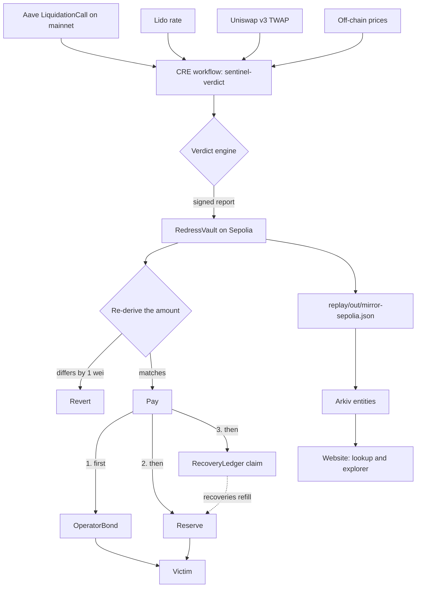

# Redress documentation

What the product is, how it flows, and what every file and folder does. To run things, see [`run_commands.md`](run_commands.md).

---

## 1. What Redress is

Redress is an automatic, evidence-based restitution layer for wrongful liquidations.

Lending protocols like Aave sell a borrower's collateral when its price falls too far. That depends on a price oracle. If the oracle is wrong, healthy borrowers get liquidated and lose real money, and today the only remedy is a slow manual process.

Redress does three things automatically:

1. **Judges** each liquidation against independent prices the broken oracle cannot touch.
2. **Pays** the victim the amount it can prove, from the oracle operator's bond first, then a shared reserve.
3. **Records** a public claim against whoever benefited, so the money can be recovered.

### The incident it replays

On 10 March 2026 a misconfigured oracle undervalued wstETH on Aave, and healthy positions were liquidated. A DAO process repaired it by hand and refunded about 512 ETH.

Redress re-runs that day from real chain data. It is a hackathon demo: the history is real, but every payout is a test token on Sepolia. It is economic restitution, not a reversal, and it handles no real funds.

### Results

| Measure | Result |
|---|---|
| Liquidation events | 47, covering 34 positions and 33 addresses |
| Verdicts | 46 `WRONGFUL`, 1 `AMBIGUOUS` |
| Positions wrongful on every event | 33 of 34 |
| Paid on Sepolia | 473.2955 test WETH, equal to the offline replay to the wei |
| Paid from the bond, then the reserve | 100 and 373.2955 |
| Against the DAO's 512.19 ETH | Floor paid −7.594%. Midpoint, for comparison only, −2.541% |
| False positives | 0 on 215 calm and 60 market-crash liquidations |
| Arkiv | 128 entities published |

The PRD's targets of 34 of 34 positions and ±2% are **not met**, and nothing was tuned to close the gap. Redress pays only what it can prove, so it sits below the DAO's figure by design.

### Sponsors

| Sponsor | How Redress uses it |
|---|---|
| **Chainlink CRE** | The whole pipeline is one CRE workflow |
| **Uniswap** | The v3 TWAP is a price source in every verdict. A v4 hook shows how v4 pools could expose a band |
| **Arkiv** | The queryable index behind the lookup and explorer |

---

## 2. Key ideas

| Term | Meaning |
|---|---|
| **Band** | The range of prices the independent sources agree on. Outliers are rejected, and it is widened by a safety margin |
| **Gate** | A cheap first check: does the oracle sit far enough from the band to need a full verdict? |
| **Health factor (HF)** | Aave's safety score. Below 1, a position can be liquidated |
| **Floor** | The lowest loss provable across the whole band. **This is what is paid** |
| **Midpoint** | The loss at the band's centre. Used for comparison only, never paid |
| **Bond** | Money an oracle operator posts against an adapter. It pays first |
| **Reserve** | The shared pool that pays what the bond cannot |
| **Epoch cap** | A limit on reserve payouts per day. Payouts that do not fit queue, and anyone can settle them later |
| **Claim** | A public record of what the liquidator and block builder benefited |
| **Adapter** | The oracle contract behind an asset, from `AaveOracle.getSourceOfAsset` |

### Verdicts

| Code | Verdict | Meaning | Pays? |
|---|---|---|---|
| 0 | `VALID` | The liquidation was justified | No |
| 1 | `WRONGFUL` | Healthy across the whole band | Yes |
| 2 | `EXCESS` | Allowed, but more was taken than was justified | Yes |
| 3 | `AMBIGUOUS` | Near the threshold | Only the provable excess |
| 4 | `INCONCLUSIVE` | Not enough evidence | No |
| 5 | `OVERPRICED` | The oracle was too high, not too low | No |

### Price sources

| Source | What | Status |
|---|---|---|
| **S1** | Lido `stEthPerToken` | Used |
| **S2** | Uniswap v3 wstETH/WETH 30-minute TWAP | Used |
| **S3** | DefiLlama | Used, provenance unconfirmed |
| **S3** | CoinGecko | Queried, and rejected as an outlier on every incident event |
| **S4** | The v4 hook on the synthetic pool | Demo only. Never in the replay |

The default config needs 3 sources.

---

## 3. How the project flows



### One liquidation, step by step

1. **Trigger.** A CRE log trigger fires on a `LiquidationCall`. In replay, the simulator is pointed at a historical transaction.
2. **Filter.** Anything other than wstETH collateral with WETH debt is skipped.
3. **Read the position.** One batched read at the block before: balances, E-Mode and account data.
4. **Read prices.** One batched read at the event block: the oracle, Lido, the Uniswap TWAP, the oracle adapter and the block's coinbase.
5. **Read off-chain prices.** An HTTP call, with consensus across nodes.
6. **Judge.** The band, gate and verdict run as pure functions.
7. **Report.** The result is encoded and written to the vault through the CRE forwarder.
8. **Check.** The vault re-derives the amount with `VerdictMath` and reverts if it differs by one wei.
9. **Pay.** Bond first, then reserve. If the reserve cannot cover its share, the whole payout queues and the bond is untouched.
10. **Claim.** The same transaction opens a claim against the liquidator and builder.

### From payouts to the website

1. `replay/mirror.ts` runs each event and checks the on-chain payment.
2. `replay/scorecard.ts` builds `replay/out/replay.json`.
3. `replay/publish-arkiv.ts` publishes verdicts, claims and recoveries.
4. `backend/api.ts` serves the data. The lookup and explorer read Arkiv, and fall back to JSON.
5. `web/public/` renders it.

### Three ways the same engine runs

| Mode | Command | Uses CRE? | Writes where |
|---|---|---|---|
| Offline replay | `bun run replay` | No | Local JSON |
| Fork | `bun replay/mirror.ts fork` | Yes | A local fork |
| Public mirror | `bun replay/mirror.ts sepolia` | Yes | Sepolia |

They share the same logic in `cre/sentinel-verdict/`, which is why their results match to the wei.

---

## 4. Deployed contracts

All on Sepolia and verified on Etherscan. The list is also in `deployments/sepolia.json`.

| Contract | Address |
|---|---|
| `RedressVault` | `0xaccfe6e8939d3143f7f70a550ebf29dcfc197609` |
| `OperatorBond` | `0x934d3fae4d7393ef34a35246b28aab0b05cddea4` |
| `RecoveryLedger` | `0x82339ee18be49be221bac62c4fb30e2f1d7a055d` |
| `MockWETH` | `0xa193cae8762aeedcbf4d73c96369b54e5100fba4` |
| `BandOracleHook` | `0xc555e1ca0a109a1f02d238455ff4feda7ba5d080` |

Arkiv: Rabdi testnet, chain ID 7794095, writer `0xD19D988fAe15c6AF0CB18FD5D79bffa41F8c2683`.

Older deployments are listed in `VERIFY.md`. Nothing current uses them.

---

## 5. Folder map

```text
redress/
├── contracts/     Solidity: vault, bond, ledger, hook, tests
├── cre/           The Chainlink CRE workflow and its pure logic
├── replay/        Incident data, replay, mirror, controls, publishing
├── backend/       API, Arkiv client, live watcher
├── web/           The website
├── arkiv/         Arkiv sponsor documents
├── docs/          Specs, design, security review, transcripts
├── deployments/   Contract addresses
└── (root)         README, PRD, checklists, config
```

---

## 6. What each file does

### Root

| File | What it does |
|---|---|
| `README.md` | The public overview, sponsor sections and results |
| `PRD.md` | The full product design, kept up to date with measured results |
| `VERIFY.md` | Register of what is confirmed, where from, and old deployments |
| `FEEDBACK.md` | Developer feedback for Uniswap |
| `SUBMISSION_CHECKLIST.md` | Every submission item: done, blocked or needs you |
| `run_commands.md` | Every command, and the hackathon routine |
| `documentation.md` | This file |
| `LICENSE` | MIT |
| `.env.example` | Template for `.env`. The real `.env` is gitignored |
| `Makefile` | Short names for the main commands |
| `package.json`, `bun.lock` | Root packages and scripts |
| `tsconfig.json` | TypeScript settings for the root project |
| `bunfig.toml` | Keeps vendored library tests out of `bun test` |
| `.gitignore`, `.gitattributes` | Ignored files and line-ending rules |
| `.gitmodules` | The Solidity library submodules |
| `.github/workflows/ci.yml` | CI: tests, types, formatting, and a VERIFY marker check |

### `contracts/`: Solidity

| File | What it does |
|---|---|
| `foundry.toml`, `foundry.lock`, `remappings.txt` | Foundry config: solc 0.8.26, fuzz and invariant sizes, import paths |
| `src/RedressVault.sol` | The core. Receives reports, re-derives the amount, pays bond then reserve, opens claims, applies the epoch cap and queue |
| `src/VerdictMath.sol` | The verdict and payout maths. Must match `verdict.ts` exactly |
| `src/OperatorBond.sol` | Holds bonds per adapter. The vault draws from it. Withdrawals wait 7 days and lapse a day later |
| `src/RecoveryLedger.sol` | One claim per payout. `receiveRecovery` refills the reserve |
| `src/hooks/BandOracleHook.sol` | The Uniswap v4 hook. Records pool ticks and serves `getBand` |
| `src/interfaces/IReceiver.sol` | The CRE receiver interface |
| `src/interfaces/IAccountability.sol` | What the vault needs from the bond and ledger |
| `src/mocks/MockWETH.sol` | Test WETH with open minting. Testnet only |
| `script/DeployVault.s.sol` | Deploys a reserve-only vault, used on the fork |
| `script/DeploySepolia.s.sol` | Deploys bond, ledger and vault, funds the reserve, posts the demo bond |
| `script/DeployHook.s.sol` | Mines the hook address, deploys it, opens the demo pool |
| `script/SwapHookPool.s.sol` | Swaps both ways so the band has data |
| `test/unit/RedressVault.t.sol` | Vault rules: strict equality, caps, queue, pause, idempotency |
| `test/unit/VerdictMath.t.sol` | Maths against the shared vectors |
| `test/unit/Accountability.t.sol` | Waterfall order, bond exhaustion, recovery accounting |
| `test/unit/BandOracleHook.t.sol` | Recording, windows, manipulation, empty history |
| `test/fuzz/VerdictMath.fuzz.t.sol` | Random inputs, and parity with TypeScript |
| `test/invariant/RedressVault.invariant.t.sol` | Vault invariants under random actions |
| `test/invariant/Accountability.invariant.t.sol` | Invariants across vault, bond and ledger together |
| `test/fork/AaveBonus.fork.t.sol` | Checks the bonus logic against real Aave state |
| `test/fork/MockForwarder.fork.t.sol` | Proves the mock forwarder accepts forged reports |
| `test/gen_vectors.py` | Python reference that generates the test vectors |
| `test/vectors.json` | Shared TypeScript and Solidity test cases |
| `test/report-fixture.json` | All 47 reports, encoded by TypeScript and accepted by the vault |
| `test/vectors-random.bin` | Generated random cases. Gitignored |
| `lib/` | Submodules: forge-std, OpenZeppelin, v4-periphery with v4-core, uniswap-hooks |

### `cre/`: the Chainlink workflow

| File | What it does |
|---|---|
| `project.yaml` | Chain RPCs per target: `fork`, `sepolia`, `demo-v4hook` |
| `sentinel-verdict/workflow.yaml` | Links each target to its config |
| `sentinel-verdict/main.ts` | Entry point: sets up the log trigger |
| `sentinel-verdict/handler.ts` | Moves data: reads the chain, calls the engine, writes the report |
| `sentinel-verdict/verdict.ts` | The verdict engine. Pure functions, must match `VerdictMath.sol` |
| `sentinel-verdict/position.ts` | Turns chain facts into engine inputs. Shared with the offline replay |
| `sentinel-verdict/bonus.ts` | Works out the effective liquidation bonus, as Aave does |
| `sentinel-verdict/report.ts` | Encodes the report. Must match `struct Verdict` in the vault |
| `sentinel-verdict/v4hook.ts` | The `v4Hook` source, and the rules keeping it out of the replay |
| `sentinel-verdict/gen-random-vectors.ts` | Generates random parity cases |
| `sentinel-verdict/config.fork.json` | Generated config for the fork |
| `sentinel-verdict/config.sepolia.json` | Generated config for Sepolia |
| `sentinel-verdict/config.demo-v4hook.json` | Generated dry-run config for the hook demo |
| `sentinel-verdict/*.test.ts` | Tests. `handler.test.ts` mocks every capability and checks all 47 events |
| `sentinel-verdict/tsconfig.json`, `package.json`, `bun.lock` | The workflow's own project, because the SDK's types differ |
| `sentinel-verdict/sources/` | Empty placeholder |

### `replay/`: data and runners

**Getting data**

| File | What it does |
|---|---|
| `onchain.ts` | Shared chain access, with error redaction so RPC URLs never print |
| `verify-onchain.mjs` | Checks on-chain facts and writes the verification report |
| `fetch-incident.ts` | Builds the incident file from chain data |
| `reads.ts` | Archive reads for one liquidation |
| `fetch-reads.ts` | Reads the incident events and the original 50 controls |
| `fetch-offchain.ts` | Fetches DefiLlama and CoinGecko prices |
| `fetch-adapters.ts` | Reads each event's oracle adapter and coinbase |
| `fetch-controls.ts` | Builds the wide calm and volatility controls |

**Running**

| File | What it does |
|---|---|
| `evaluate.ts` | Runs the engine over cached reads |
| `replay.ts` | Offline replay under every config |
| `scorecard.ts` | Compares with the DAO figures and writes `replay.json` |
| `build-replay.ts` | Builds `replay.json` and its mock version |
| `mirror.ts` | Runs each event through real CRE and checks the on-chain payment |
| `controls.ts` | Runs the seven negative controls |
| `demo-v4hook.ts` | The hook demo. A dry run |
| `rehearse-fork.ts` | Sends the reports through the mock forwarder without CRE. Not re-run since the report format changed |
| `serve-snapshot.ts` | Serves the committed prices to the workflow |
| `publish-arkiv.ts` | Publishes to Arkiv in batches, and can resume |
| `gen-cre-config.ts` | Generates the workflow configs |
| `gen-report-fixture.ts` | Generates the Solidity report fixture |

**Shell scripts**

| File | What it does |
|---|---|
| `fork-up.sh` | Starts the local fork, pinned to a block after the incident |
| `fork-deploy.sh` | Deploys and funds a vault on the fork |
| `deploy-sepolia.sh` | Deploys bond, ledger and vault, and checks the chain agrees |
| `deploy-hook.sh` | Deploys the hook and demo pool, and swaps |

**`replay/data/`: committed inputs**

| File | What it holds |
|---|---|
| `incident-2026-03-10.json` | The incident's liquidations |
| `incident-reads.json` | Archive state for the 47 events |
| `incident-adapters.json` | Oracle adapter and coinbase per event |
| `offchain-prices.json` | The off-chain price snapshot |
| `control-reads.json` | The original 50 control events |
| `control-wide-reads.json` | 215 calm and 60 volatility events |
| `control-wide-offchain.json` | Prices for those, and how the crash day was chosen |
| `verification-report.txt` | Output of the on-chain verification |

**`replay/out/`: generated results**

| File | What it holds |
|---|---|
| `replay.json` | **The main result, and the frontend's data contract** |
| `replay.mock.json` | Synthetic data covering every page state, marked `mock: true` |
| `results-default.json` | Per-event results, default config |
| `results-onchain-only-2src.json` | Per-event results, two on-chain sources |
| `mirror-sepolia.json` | All 47 Sepolia payouts, with bond and reserve shares |
| `mirror-sepolia-v1.json` | The earlier reserve-only run, kept as a record |
| `mirror-fork.json` | All 47 fork runs |
| `rehearsal-fork.json` | An old rehearsal. Never a real payout |
| `controls.json` | The seven control results |
| `live.json` | The latest live scan |
| `arkiv.json` | Writer, entity keys and batch transactions |
| `demo-v4hook.json` | The hook demo result, labelled synthetic |

**Tests:** `contract.test.ts` (data contract), `controls.test.ts`, `evaluate.test.ts`, `fetch-offchain.test.ts`, `mirror.test.ts`, `onchain.test.ts` (including the redaction test).

### `backend/`

| File | What it does |
|---|---|
| `api.ts` | Serves the site and the API. Reports whether Arkiv or JSON answered |
| `arkiv.ts` | Arkiv schemas, reader, writer, lookup and explorer queries, and the fallback |
| `entities.ts` | Pure functions that turn results into Arkiv values |
| `watcher.ts` | Live mode: scans recent real liquidations, runs the real engine, pays nothing |
| `entities.test.ts`, `backend.test.ts` | Tests |

### `web/`

| File | What it does |
|---|---|
| `public/index.html` | The six pages |
| `public/app.js` | All page logic, plus the stress calculator |
| `public/style.css` | The black-and-white design |
| `lib/lookup.ts` | The lookup logic and the `VerdictSource` interface |
| `README.md` | Which page reads what |

**The six pages:**

| Page | What it shows |
|---|---|
| Overview | The incident, the six steps, and the comparison with the DAO |
| Was I wronged? | Every verdict for an address |
| Replay | The incident block by block, oracle against band |
| Explorer | Filters over all verdicts, run on Arkiv |
| Reserve | Bond and reserve shares, claims, and a stress calculator |
| Live | Recent real liquidations and the negative controls |

### `arkiv/`

| File | What it covers |
|---|---|
| `schema.md` | Entities, attributes, owner, expiry and a runnable query |
| `friction.md` | Real problems we hit |
| `why-arkiv.md` | What users would lose with Postgres |
| `how-you-use-arkiv.md` | Filters, ownership, expiry, and what stays off Arkiv |
| `reach.md` | Who it is for. Whether it ships after Mumbai is undecided |
| `swarm.md` | States that Swarm is not built |

### `docs/`

| File | What it covers |
|---|---|
| `VERDICT_SPEC.md` | The normative definition of the engine, with decisions D1 to D21 |
| `HOOK_DESIGN.md` | The hook's design, honest role and limits |
| `SECURITY.md` | The security review: every finding and its status |
| `replay.schema.json` | The schema for `replay.json` |
| `transcripts/sepolia.txt` | The real CRE simulation with `--broadcast`, for the first event |
| `transcripts/fork.txt` | The same on the fork |
| `transcripts/demo-v4hook.txt` | The hook demo run |
| `transcripts/sepolia-v1.txt` | The earlier reserve-only run |

### `deployments/`

| File | What it holds |
|---|---|
| `sepolia.json` | The current Sepolia addresses |
| `sepolia-v1.json` | The earlier reserve-only deployment |
| `fork.json` | The local fork vault |

---

## 7. Rules that must stay true

If you change the code, keep these in step:

| Rule | Files |
|---|---|
| Verdict logic matches exactly | `verdict.ts` and `VerdictMath.sol`, checked by `vectors.json` |
| The report format matches exactly | `report.ts` and `struct Verdict` in `RedressVault.sol` |
| The floor is paid, never the midpoint | The vault and `replay.json` |
| The v4 hook never reaches the replay | `v4hook.ts`, enforced by tests |
| No secrets in the repo or in output | `.env`, redaction in `onchain.ts` and `mirror.ts` |
| Results are never tuned to fit | Differences are reported as measured |

---

## 8. Limits and trust

Read `docs/SECURITY.md` and the README for detail. In short:

- **Anyone can forge a report against this vault.** It uses the mock forwarder, so it must only hold test tokens.
- **The vault checks arithmetic, not facts.** It cannot see mainnet, so it trusts the report.
- **A registrar names bond operators.** It cannot move funds.
- **Claims are records.** Nothing can force anyone to pay.
- **CRE ran as a one-node local simulation,** so consensus across nodes was not exercised.
- **This is log replay.** The workflow reads history and the original liquidations are not run again.
- **Off-chain prices are a committed snapshot,** and DefiLlama is the only working series.
- **One manipulated source can block a legitimate payout.** Negative control 5 fails.
- **The v4 pool is synthetic.**
- **Swarm is not built.** It needs a postage batch and a Bee endpoint.
- **The security review is a self-review,** not an independent audit.
